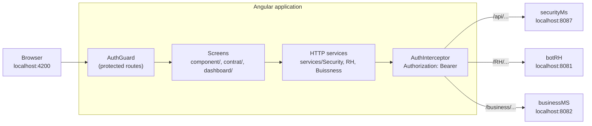

# CollaboratorBook — front end (Angular)

[Français](README.md) · **English**

Angular client of CollaboratorBook, an internal social network and HR platform for companies. End-of-studies project
built at DITRIOT Consulting (2022–2023), migrated from Angular 13 to Angular 21 in 2026.

Back end (Spring Boot microservices): [CollaboratorBook_BACK](https://github.com/rachedchakchouk/CollaboratorBook_BACK).
The full application needs both repositories: see [Running with the back end](#running-with-the-back-end).

## Overview

- **Authentication**: sign-in, sign-up of a company and its manager, route guard and automatic sending of the JWT with
  API calls.
- **Social network**: company news feed (posts with images, comments, archiving).
- **Collaborators**: employee profiles (job, documents, contracts, projects, posts), multi-step employee creation,
  editing, archiving and reactivation.
- **HR**: contracts and clauses, leave, projects.
- **Company structure**: offices and departments.
- **Dashboard**: widgets from the original admin template, with static data.

## Tech stack

Versions installed by `npm ci` (`package-lock.json` file).

| Layer | Technology | Version |
|---|---|---|
| Framework | Angular (`@angular/core`) · Angular CLI | 21.2.25 · 21.2.29 |
| Language | TypeScript | 5.9.3 |
| Reactive programming | RxJS · zone.js | 7.8.2 · 0.15.1 |
| Components | PrimeNG (Lara theme, `@primeuix/themes` 2.0.3) · PrimeIcons · PrimeFlex | 21.1.10 · 4.1.0 · 3.3.0 |
| Components | Ignite UI for Angular (`igniteui-angular`) | 21.2.23 |
| Layout | Bootstrap · Bootstrap Icons · ng-bootstrap | 5.2.2 · 1.9.1 · 20.0.0 |
| Charts | ApexCharts · ng-apexcharts | 8.6.0 · 3.2.0 |
| JWT | `@auth0/angular-jwt` | 5.2.0 |
| Styles | Sass | 1.97.3 |
| Tests | Karma · Jasmine | 6.4.4 · 5.6.0 |
| Build | `@angular-devkit/build-angular` (`browser` builder, webpack) | 21.2.29 |
| Runtime | Node.js (required by Angular 21) | `^20.19.0`, `^22.12.0` or `>=24.0.0` |

## Architecture



- NgModule-based application (`AppModule`, components with `standalone: false`) bootstrapped in `src/main.ts`.
- Routes are declared in `src/app/app-routing.module.ts`; lazy-loaded modules: `AuthentificationModule`,
  `DashboardModule`, `AboutModule`, `ComponentsModule` (routes in `src/app/component/component.routing.ts`) and
  `ContratModule`.
- Protected pages are rendered inside the `FullComponent` layout (`shared/header` header, `shared/sidebar` menu).
- The HTTP services call the three back-end services directly, without going through the `cloud-gateway` gateway.
- After sign-in, `localStorage` holds `accessToken`, `refreshToken`, `userName`, `idemployee` and `companyid`; screens
  rely on `companyid` and `idemployee` to load their data.
- PrimeNG theme: Lara preset with a blue primary colour, dark mode disabled (`providePrimeNG` in `app.module.ts`); admin
  template styles in `src/assets/scss/`.

Components keep the names of the original admin template (`alert`, `badges`, `pagination`…); the table below gives
their actual purpose.

| Route | Component | Purpose |
|---|---|---|
| `/` (and `/singnin`) | `SigninComponent` | Sign-in |
| `/signup` | `SignupComponent` | Sign-up of a company and its manager (`POST /business/Companies/newCompany`) |
| `/update-profile/:id` | `UpdateProfileComponent` | Profile form, with no back-end call |
| `/dashboard` | `DashboardComponent` | Template dashboard, static data |
| `/component/home` | `HomeComponent` | News feed: posts with images, comments, archiving |
| `/component/alert` | `NgbdAlertBasicComponent` | Collaborators: an employee's profile (job, projects, posts) and the members of their projects |
| `/component/badges` | `BadgeComponent` | Detailed employee profile: documents, contract, projects, posts |
| `/component/employees` | `ButtonsComponent` | Employee record: active and archived contracts, archiving and reactivation |
| `/component/employee` | `CardsComponent` | Employee editing |
| `/component/newemployee` | `StepsComponent` | Multi-step employee creation: details, documents, contract, clauses |
| `/component/pagination` | `NgbdpaginationBasicComponent` | Leave of the signed-in employee |
| `/component/table` | `TableComponent` | Company projects: creation, employee assignment |
| `/component/offices`, `/component/newOffice` | `OfficesComponent`, `AddOfficeComponent` | Offices and departments, adding an office |
| `/contract` (`ajoutercontract`, `ajouterclose`, `closes`) | `ContratModule` | Contracts (creation, editing, archiving, assignment) and clauses |
| `/about`, `/component/dropdown`, `/component/nav` | — | Template demo pages |

## Repository layout

```text
CollaboratorBook_FRONT/
├── src/
│   ├── app/
│   │   ├── core/              # AuthGuard, AuthInterceptor
│   │   ├── services/          # HTTP calls: Security/, RH/, Buissness/
│   │   ├── component/         # screens: authentication, news feed, employees, offices, leave, projects
│   │   ├── contrat/           # contracts and clauses module
│   │   ├── dashboard/         # dashboard (template widgets)
│   │   ├── layouts/full/      # layout of the protected pages
│   │   ├── shared/            # header, side menu, loading indicator
│   │   └── app.module.ts, app-routing.module.ts
│   ├── models/                # TypeScript classes for the resources (Employee, Company, Contract…)
│   ├── environments/          # environment.ts, environment.prod.ts
│   └── assets/                # images, logos, SCSS styles
├── angular.json               # ample-admin-angular project: build, serve, test
├── karma.conf.js              # test configuration
├── package.json, package-lock.json, .npmrc
└── .github/dependabot.yml     # weekly npm updates
```

## Prerequisites

- Node.js `^20.19.0`, `^22.12.0` or `>=24.0.0` (required by Angular 21) and npm.
- The [CollaboratorBook_BACK](https://github.com/rachedchakchouk/CollaboratorBook_BACK) back end running, to sign in
  and use the screens.
- Google Chrome for the tests (Karma).
- Access to `fonts.googleapis.com` for the production build.

## Running locally

The commands are the same on Windows (PowerShell), Linux and macOS.

```bash
git clone https://github.com/rachedchakchouk/CollaboratorBook_FRONT.git
cd CollaboratorBook_FRONT
npm ci
npm start
```

- `npm ci` installs the exact versions from `package-lock.json`; `.npmrc` enables `legacy-peer-deps=true`.
- `npm start` runs `ng serve` (`development` configuration): the application is served on http://localhost:4200.
- Without the back end, the sign-in and sign-up pages are displayed, but signing in fails.

### Running with the back end

1. Start MySQL, then the back end by following its [README](https://github.com/rachedchakchouk/CollaboratorBook_BACK#readme):
   `eureka-server` (8761), then `securityMs` (8087, `JWT_SECRET`, `DB_USERNAME`, `DB_PASSWORD` variables), `botRH`
   (8081) and `businessMS` (8082). The `cloud-gateway` gateway is not used by the front end.
2. Create the `ADMIN`, `RH`, `EMPLOYEE`, `SUPER_USER` and `ROBOT` roles once with
   `POST http://localhost:8087/api/role/save` (commands in the back-end README).
3. Start the front end: `npm start`.
4. Open http://localhost:4200/signup and register a company: its manager becomes an administrator.
5. Sign in at http://localhost:4200 with the manager's e-mail address; their initial password is their first name.

## Configuration

There are no environment variables and no `.env` file. The back-end addresses are written in the code:

| Back-end service | Address | Files |
|---|---|---|
| securityMs | `http://localhost:8087/api/...` | `src/app/services/Security/*.service.ts`, `src/app/component/autentification/signin/signin.component.ts` |
| botRH | `http://localhost:8081/RH/...` | `src/app/services/RH/*.service.ts`, `src/app/component/home/home.component.ts` |
| businessMS | `http://localhost:8082/business/...` | `src/app/services/Buissness/*.service.ts` |

- `src/environments/environment.ts` and `environment.prod.ts` define `production` and `gatewayUrl`
  (`http://localhost:8888`, the gateway address). `gatewayUrl` only appears in commented-out lines of the services. The
  production build replaces `environment.ts` with `environment.prod.ts`.
- `src/proxy.conf.json` (proxy to `http://localhost:8888`) is not referenced by `angular.json` or by the npm scripts.
- Port: 4200, the `ng serve` default and the only origin allowed by the gateway's CORS configuration; the back-end
  services accept any origin.

| npm script | Command | Purpose |
|---|---|---|
| `npm start` | `ng serve` | Development server on http://localhost:4200 |
| `npm run build` | `ng build` | Production build in `dist/ample-admin-angular/` |
| `npm test` | `ng test` | Karma / Jasmine tests in Chrome, in watch mode |
| `npm run ng -- <command>` | `ng` | Angular CLI |

## Tests

- `npm test` opens Chrome and reruns the tests on every change (`singleRun: false` in `karma.conf.js`).
- Single headless run:

  ```bash
  npx ng test --watch=false --browsers=ChromeHeadless
  ```

- The tests check that four components can be created: `CompanyComponent`, `DocumentComponent`, `JobComponent` and
  `UpdateProfileComponent`.
- No linter is configured (no ESLint; `tslint.json` was removed during the migration to Angular 21).
- `src/karma.conf.js` is an old, unused configuration: `angular.json` points to the root `karma.conf.js`.

## Build, CI and deployment

- `npm run build` uses the `production` configuration by default: output in `dist/ample-admin-angular/`, hashed file
  names, `environment.prod.ts`, budgets (initial bundle: error above 5 MB; component styles: warning at 2 kB, error at
  4 kB). Optimisation inlines the Google Fonts stylesheets into `index.html`, so the build needs access to
  `fonts.googleapis.com`.
- Development build, without optimisation: `npx ng build --configuration development`.
- **CI**: no GitHub Actions workflow.
- **Dependabot** (`.github/dependabot.yml`): npm, every Monday at 06:00 (Africa/Tunis), at most five open PRs, `deps`
  prefix, `dépendances` label. Groups: security, Angular, other minor and patch updates. Major versions of Angular,
  TypeScript, zone.js, PrimeNG, `@primeuix/themes`, Ignite UI, ng-bootstrap and ng-apexcharts are ignored.
- **Deployment**: no hosting configuration in the repository. URLs do not use `#` (`PathLocationStrategy`), so the web
  server must return `index.html` for any unknown route.

## Security

- `AuthGuard` (`src/app/core/auth.guard.ts`) lets the navigation through if `localStorage` holds an `accessToken` that
  has not expired (`JwtHelperService`); otherwise it removes the token and redirects to `/`. It protects
  `/update-profile/:id` and every `FullComponent` page (`/dashboard`, `/about`, `/component/...`, `/contract`).
- `AuthInterceptor` (`src/app/core/auth.interceptor.ts`) adds `Authorization: Bearer <accessToken>` to every
  `HttpClient` request, except those ending with `/api/login`.
- Tokens are kept in `localStorage`. The access token lasts 10 minutes; `LoginService` contains refresh logic, but no
  route uses it: once the token has expired, the guard sends the user back to the sign-in page on the next navigation.
- No screen is restricted by role (the role is only displayed); the back end does not check roles either (see its
  README).

## License

All rights reserved: the code is published for review as part of a portfolio. See [LICENSE](LICENSE).

## Author

**Rached Chakchouk** — Full Stack Software Engineer (Java / Spring Boot / Angular)
[LinkedIn](https://www.linkedin.com/in/rached-chakchouk) · [Portfolio](https://rached-chakchouk.netlify.app)
