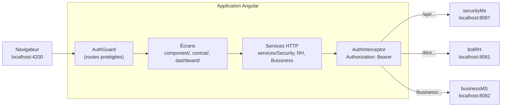

# CollaboratorBook — front-end (Angular)

**Français** · [English](README.en.md)

Client Angular de CollaboratorBook, réseau social interne et plateforme RH pour les entreprises. Projet de fin d'études
réalisé chez DITRIOT Consulting (2022–2023), migré d'Angular 13 à Angular 21 en 2026.

Back-end (microservices Spring Boot) : [CollaboratorBook_BACK](https://github.com/rachedchakchouk/CollaboratorBook_BACK).
L'application complète a besoin des deux dépôts : voir [Lancer avec le back-end](#lancer-avec-le-back-end).

## Aperçu

- **Authentification** : connexion, inscription d'une entreprise et de son gérant, garde de route et envoi automatique
  du jeton JWT avec les appels d'API.
- **Réseau social** : fil d'actualité de l'entreprise (publications avec image, commentaires, archivage).
- **Collaborateurs** : profils des employés (poste, documents, contrats, projets, publications), création d'un employé
  en plusieurs étapes, modification, archivage et réactivation.
- **RH** : contrats et clauses, congés, projets.
- **Structure de l'entreprise** : bureaux et départements.
- **Tableau de bord** : widgets du modèle d'administration d'origine, avec des données statiques.

## Stack technique

Versions installées par `npm ci` (fichier `package-lock.json`).

| Couche | Technologie | Version |
|---|---|---|
| Framework | Angular (`@angular/core`) · Angular CLI | 21.2.25 · 21.2.29 |
| Langage | TypeScript | 5.9.3 |
| Programmation réactive | RxJS · zone.js | 7.8.2 · 0.15.1 |
| Composants | PrimeNG (thème Lara, `@primeuix/themes` 2.0.3) · PrimeIcons · PrimeFlex | 21.1.10 · 4.1.0 · 3.3.0 |
| Composants | Ignite UI for Angular (`igniteui-angular`) | 21.2.23 |
| Mise en page | Bootstrap · Bootstrap Icons · ng-bootstrap | 5.2.2 · 1.9.1 · 20.0.0 |
| Graphiques | ApexCharts · ng-apexcharts | 8.6.0 · 3.2.0 |
| JWT | `@auth0/angular-jwt` | 5.2.0 |
| Styles | Sass | 1.97.3 |
| Tests | Karma · Jasmine | 6.4.4 · 5.6.0 |
| Build | `@angular-devkit/build-angular` (builder `browser`, webpack) | 21.2.29 |
| Environnement | Node.js (exigence d'Angular 21) | `^20.19.0`, `^22.12.0` ou `>=24.0.0` |

## Architecture



- Application à modules NgModule (`AppModule`, composants `standalone: false`) démarrée dans `src/main.ts`.
- Routes déclarées dans `src/app/app-routing.module.ts` ; modules chargés à la demande : `AuthentificationModule`,
  `DashboardModule`, `AboutModule`, `ComponentsModule` (routes dans `src/app/component/component.routing.ts`) et
  `ContratModule`.
- Les pages protégées s'affichent dans la mise en page `FullComponent` (en-tête `shared/header`, menu `shared/sidebar`).
- Les services HTTP appellent directement les trois services du back-end, sans passer par la passerelle
  `cloud-gateway`.
- Après la connexion, `localStorage` contient `accessToken`, `refreshToken`, `userName`, `idemployee` et `companyid` ;
  les écrans s'appuient sur `companyid` et `idemployee` pour charger leurs données.
- Thème PrimeNG : préréglage Lara à couleur primaire bleue, mode sombre désactivé (`providePrimeNG` dans
  `app.module.ts`) ; styles du modèle d'administration dans `src/assets/scss/`.

Les composants gardent les noms du modèle d'administration d'origine (`alert`, `badges`, `pagination`…) ; le tableau
ci-dessous donne leur rôle réel.

| Route | Composant | Rôle |
|---|---|---|
| `/` (et `/singnin`) | `SigninComponent` | Connexion |
| `/signup` | `SignupComponent` | Inscription d'une entreprise et de son gérant (`POST /business/Companies/newCompany`) |
| `/update-profile/:id` | `UpdateProfileComponent` | Formulaire de profil, sans appel au back-end |
| `/dashboard` | `DashboardComponent` | Tableau de bord du modèle, données statiques |
| `/component/home` | `HomeComponent` | Fil d'actualité : publications avec image, commentaires, archivage |
| `/component/alert` | `NgbdAlertBasicComponent` | Collaborateurs : profil d'un employé (poste, projets, publications) et membres de ses projets |
| `/component/badges` | `BadgeComponent` | Profil détaillé d'un employé : documents, contrat, projets, publications |
| `/component/employees` | `ButtonsComponent` | Fiche d'un employé : contrats actifs et archivés, archivage et réactivation |
| `/component/employee` | `CardsComponent` | Modification d'un employé |
| `/component/newemployee` | `StepsComponent` | Création d'un employé en plusieurs étapes : informations, documents, contrat, clauses |
| `/component/pagination` | `NgbdpaginationBasicComponent` | Congés de l'employé connecté |
| `/component/table` | `TableComponent` | Projets de l'entreprise : création, affectation d'employés |
| `/component/offices`, `/component/newOffice` | `OfficesComponent`, `AddOfficeComponent` | Bureaux et départements, ajout d'un bureau |
| `/contract` (`ajoutercontract`, `ajouterclose`, `closes`) | `ContratModule` | Contrats (création, modification, archivage, attribution) et clauses |
| `/about`, `/component/dropdown`, `/component/nav` | — | Pages de démonstration du modèle |

## Structure du dépôt

```text
CollaboratorBook_FRONT/
├── src/
│   ├── app/
│   │   ├── core/              # AuthGuard, AuthInterceptor
│   │   ├── services/          # appels HTTP : Security/, RH/, Buissness/
│   │   ├── component/         # écrans : authentification, fil d'actualité, employés, bureaux, congés, projets
│   │   ├── contrat/           # module des contrats et des clauses
│   │   ├── dashboard/         # tableau de bord (widgets du modèle)
│   │   ├── layouts/full/      # mise en page des pages protégées
│   │   ├── shared/            # en-tête, menu latéral, indicateur de chargement
│   │   └── app.module.ts, app-routing.module.ts
│   ├── models/                # classes TypeScript des ressources (Employee, Company, Contract…)
│   ├── environments/          # environment.ts, environment.prod.ts
│   └── assets/                # images, logos, styles SCSS
├── angular.json               # projet ample-admin-angular : build, serve, test
├── karma.conf.js              # configuration des tests
├── package.json, package-lock.json, .npmrc
└── .github/dependabot.yml     # mises à jour npm hebdomadaires
```

## Prérequis

- Node.js `^20.19.0`, `^22.12.0` ou `>=24.0.0` (exigence d'Angular 21) et npm.
- Le back-end [CollaboratorBook_BACK](https://github.com/rachedchakchouk/CollaboratorBook_BACK) démarré pour se
  connecter et utiliser les écrans.
- Google Chrome pour les tests (Karma).
- Un accès à `fonts.googleapis.com` pour le build de production.

## Installation et lancement en local

Les commandes sont identiques sous Windows (PowerShell), Linux et macOS.

```bash
git clone https://github.com/rachedchakchouk/CollaboratorBook_FRONT.git
cd CollaboratorBook_FRONT
npm ci
npm start
```

- `npm ci` installe les versions exactes de `package-lock.json` ; `.npmrc` active `legacy-peer-deps=true`.
- `npm start` lance `ng serve` (configuration `development`) : application sur http://localhost:4200.
- Sans le back-end, les pages de connexion et d'inscription s'affichent, mais la connexion échoue.

### Lancer avec le back-end

1. Démarrez MySQL, puis le back-end en suivant son [README](https://github.com/rachedchakchouk/CollaboratorBook_BACK#readme) :
   `eureka-server` (8761), puis `securityMs` (8087, variables `JWT_SECRET`, `DB_USERNAME`, `DB_PASSWORD`), `botRH`
   (8081) et `businessMS` (8082). La passerelle `cloud-gateway` n'est pas utilisée par le front.
2. Créez une seule fois les rôles `ADMIN`, `RH`, `EMPLOYEE`, `SUPER_USER` et `ROBOT` avec
   `POST http://localhost:8087/api/role/save` (commandes dans le README du back-end).
3. Lancez le front : `npm start`.
4. Ouvrez http://localhost:4200/signup et inscrivez une entreprise : son gérant devient administrateur.
5. Connectez-vous sur http://localhost:4200 avec l'e-mail du gérant ; son mot de passe initial est son prénom.

## Configuration

Il n'y a ni variable d'environnement ni fichier `.env`. Les adresses du back-end sont écrites dans le code :

| Service du back-end | Adresse | Fichiers |
|---|---|---|
| securityMs | `http://localhost:8087/api/...` | `src/app/services/Security/*.service.ts`, `src/app/component/autentification/signin/signin.component.ts` |
| botRH | `http://localhost:8081/RH/...` | `src/app/services/RH/*.service.ts`, `src/app/component/home/home.component.ts` |
| businessMS | `http://localhost:8082/business/...` | `src/app/services/Buissness/*.service.ts` |

- `src/environments/environment.ts` et `environment.prod.ts` définissent `production` et `gatewayUrl`
  (`http://localhost:8888`, adresse de la passerelle). `gatewayUrl` n'apparaît que dans des lignes commentées des
  services. Le build de production remplace `environment.ts` par `environment.prod.ts`.
- `src/proxy.conf.json` (proxy vers `http://localhost:8888`) n'est référencé ni par `angular.json` ni par les scripts npm.
- Port : 4200, valeur par défaut de `ng serve` et seule origine autorisée par la configuration CORS de la passerelle ;
  les services du back-end acceptent toutes les origines.

| Script npm | Commande | Rôle |
|---|---|---|
| `npm start` | `ng serve` | Serveur de développement sur http://localhost:4200 |
| `npm run build` | `ng build` | Build de production dans `dist/ample-admin-angular/` |
| `npm test` | `ng test` | Tests Karma / Jasmine dans Chrome, en mode surveillance |
| `npm run ng -- <commande>` | `ng` | Angular CLI |

## Tests

- `npm test` ouvre Chrome et relance les tests à chaque modification (`singleRun: false` dans `karma.conf.js`).
- Exécution unique, sans fenêtre :

  ```bash
  npx ng test --watch=false --browsers=ChromeHeadless
  ```

- Les tests vérifient la création de quatre composants : `CompanyComponent`, `DocumentComponent`, `JobComponent` et
  `UpdateProfileComponent`.
- Aucun linter n'est configuré (pas d'ESLint ; `tslint.json` a été retiré lors de la migration vers Angular 21).
- `src/karma.conf.js` est une ancienne configuration, non utilisée : `angular.json` pointe vers `karma.conf.js` à la
  racine.

## Build, CI et déploiement

- `npm run build` utilise la configuration `production` par défaut : sortie dans `dist/ample-admin-angular/`, noms de
  fichiers hachés, `environment.prod.ts`, budgets (bundle initial : erreur au-delà de 5 Mo ; styles d'un composant :
  avertissement à 2 ko, erreur à 4 ko). L'optimisation intègre les feuilles Google Fonts dans `index.html` : le build a
  besoin d'un accès à `fonts.googleapis.com`.
- Build de développement, sans optimisation : `npx ng build --configuration development`.
- **CI** : aucun workflow GitHub Actions.
- **Dependabot** (`.github/dependabot.yml`) : npm, chaque lundi à 06:00 (Africa/Tunis), cinq PR ouvertes au plus,
  préfixe `deps`, label `dépendances`. Groupes : sécurité, Angular, autres mises à jour mineures et correctives. Les
  versions majeures d'Angular, TypeScript, zone.js, PrimeNG, `@primeuix/themes`, Ignite UI, ng-bootstrap et
  ng-apexcharts sont ignorées.
- **Déploiement** : aucune configuration d'hébergement dans le dépôt. Les URL n'utilisent pas de `#`
  (`PathLocationStrategy`) : le serveur web doit renvoyer `index.html` pour toute route inconnue.

## Sécurité

- `AuthGuard` (`src/app/core/auth.guard.ts`) laisse passer si `localStorage` contient un `accessToken` non expiré
  (`JwtHelperService`) ; sinon il supprime le jeton et renvoie vers `/`. Il protège `/update-profile/:id` et toutes les
  pages de `FullComponent` (`/dashboard`, `/about`, `/component/...`, `/contract`).
- `AuthInterceptor` (`src/app/core/auth.interceptor.ts`) ajoute `Authorization: Bearer <accessToken>` à toutes les
  requêtes `HttpClient`, sauf celles qui se terminent par `/api/login`.
- Les jetons sont conservés dans `localStorage`. Le jeton d'accès dure 10 minutes ; `LoginService` contient une logique
  de rafraîchissement, mais aucune route ne l'utilise : après expiration, la garde renvoie vers la page de connexion à la
  navigation suivante.
- Aucun écran n'est restreint selon le rôle (le rôle est seulement affiché) ; le back-end ne contrôle pas les rôles non
  plus (voir son README).

## Licence

Tous droits réservés : le code est publié pour consultation dans le cadre d'un portfolio. Voir [LICENSE](LICENSE).

## Auteur

**Rached Chakchouk** — ingénieur logiciel Full Stack (Java / Spring Boot / Angular)
[LinkedIn](https://www.linkedin.com/in/rached-chakchouk) · [Portfolio](https://rached-chakchouk.netlify.app)
